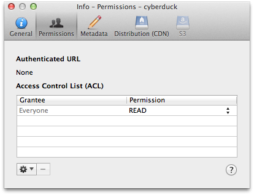
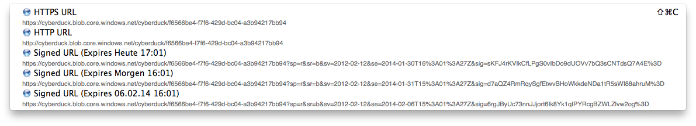

Azure Blob Storage
====

:::{image} _images/azure.png
:alt: Azure Blob Storage
:width: 128px
:::

> Massively scalable object storage for unstructured data

## Connecting to Azure Blob Storage

### Hostname

Edit the hostname to connect to your account in the format `<account>.blob.core.windows.net`.

:::{warning}
Azure Files Storage is not supported.
:::

### Credentials

#### Account and Key

Obtain the login credentials _Storage Account Name_ and _Primary Access Key_ from [portal.azure.com](https://portal.azure.com/). You can find the keys in the section *Access keys*.

#### Shared Access Signatures (SAS)

You can use a [SAS](https://docs.microsoft.com/en-us/azure/storage/common/storage-sas-overview) when you want to provide access to resources in your storage account to any client not possessing your storage account's access keys.

:::{note}
Connection profiles can be installed from *Preferences → Profiles*.
:::

- {download}`Download<https://profiles.cyberduck.io/Azure%20(Shared%20Access%20Signature%20Token).cyberduckprofile>` the *Azure (Shared Access Signature Token)* for preconfigured settings.

#### Microsoft Entra ID

Authenticate with your Microsoft Entra ID account instead of using an access key. Access to blob data is then authorized with [Azure role-based access control (Azure RBAC)](https://learn.microsoft.com/en-us/azure/storage/blobs/authorize-access-azure-active-directory) and an OAuth 2.0 access token, so no storage account key must be shared.

:::{admonition} Requirements
:class: warning
* Cyberduck [9.6.0](https://cyberduck.io/changelog/) or later required
* The signed-in user must be assigned a data role such as *Storage Blob Data Contributor* and the permission to read the account information. Follow the steps in [Set Up Permissions for Microsoft Entra ID Authentication to Azure Blob Storage](../tutorials/azure_entra_id_permissions.md).
:::

1. Choose the *Azure (Microsoft Entra ID)* connection profile when creating a bookmark. The profile is bundled by default and can also be installed from *Preferences → Profiles*.
2. Edit the hostname to connect to your account in the format `<account>.blob.core.windows.net`.
3. No credentials must be entered for opening a connection, but instead you need to log in to your Microsoft account and grant access in your web browser after choosing _Connect_. Allow to _"Open Cyberduck"_ in your web browser to submit the authorization code. Subsequent connections will not require authorization, unless the refresh token expired due to inactivity.

The OAuth tokens are saved in your keychain separately for every storage account, using the storage account name as the username of the bookmark.

:::{note}
Cyberduck uses the permission *Get Account Information* to detect whether the storage account has a hierarchical namespace enabled. Without it, connecting fails with `AuthorizationPermissionMismatch`. See [Troubleshooting](../tutorials/azure_entra_id_permissions.md#troubleshooting).
:::

### Cyberduck CLI

You can list all containers with [Cyberduck CLI](https://duck.sh/) using

```
duck --username <storageaccount> --list azure://<storageaccount>.blob.core.windows.net/`
```

For a storage account named `kahy9boj3eib` that would be 

```
duck --username kahy9boj3eib --list azure://kahy9boj3eib.blob.core.windows.net/
```

Refer to the [Cyberduck CLI](../cli/index.md) documentation for more operations.

## Access Control (ACL)

You can edit ACLs in *File → Info (macOS `⌘I` Windows `Alt+Return`) → Permissions*. To make objects in a container publicly accessible, choose *Everyone → READ*. Note that this applies to all files in a container.



## Containers

To create a new container in your account, browse to the root and choose *File → New Folder... (macOS `⇧⌘N` Windows `Ctrl+Shift+N`)*.

## Blob Type

Uploads are stored as append blob type by default. You can use the [hidden configuration option](../tutorials/hidden_properties.md) `azure.upload.blobtype` which allows the values `BLOCK_BLOB`, `PAGE_BLOB` and `APPEND_BLOB`.

## Metadata

You can edit standard custom metadata. Choose *File → Info → Metadata* to edit custom headers.

### Default Metadata

Currently only possible using a [hidden configuration option](../tutorials/hidden_properties.md) you can define default headers to be added for uploads. Multiple headers must be separated using a whitespace delimiter. Key and value of a header are separated with `=`. For example, if you want to add an HTTP header for `Cache-Control` and one named `Creator` you would set

```
azure.metadata.default="Cache-Control=public,max-age=86400 Creator=Cyberduck"
```

### Shared Access Signature URLs

A private object stored in Azure Storage can be made publicly available for a limited time using a signed URL. The signed URL can be used by anyone to download the object, yet it includes a date and time after which the URL will no longer work. Copy the signed URL from *Edit → Copy URL→ Signed URL*.



:::{note}
Currently only signed URLs with a validity of 24 hours are available.
:::

### Access Logs

Configure access logging for buckets in the *Info* panel.

:::{image} _images/Azure_tab_info_macOS.png
:alt: Windows Azure Blob Storage
:width: 500px
:::

## Limitations

- Container and blob [naming conventions](https://docs.microsoft.com/en-us/rest/api/storageservices/Naming-and-Referencing-Containers--Blobs--and-Metadata).
- [CDN configuration](https://docs.microsoft.com/en-us/azure/cdn/cdn-create-new-endpoint) is currently only possible using the web interface.

## Problems

### One of the Request Inputs is out of Range

Please follow the [Naming and Referencing Containers, Blobs, and Metadata](https://docs.microsoft.com/en-us/rest/api/storageservices/Naming-and-Referencing-Containers--Blobs--and-Metadata) guidelines.