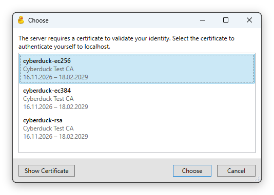
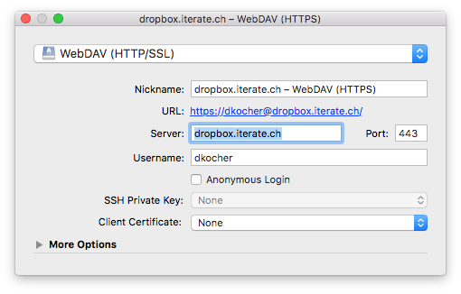

WebDAV
====

:::{toctree}
:hidden:
:titlesonly:
providers
:::

You can connect to any WebDAV compliant server using both HTTP and HTTP/SSL. Mutual TLS with a client certificate for
authentication is supported.

## Providers

Settings are specific to service [providers](providers.md).

:::{note}
Connection profiles can be installed from *Preferences → Profiles*.
:::

## Supported Authentication Methods

### HTTP Basic Authentication

Basic Authentication should only be used when using a secured connection over TLS (HTTPS).

### HTTP Digest Authentication

Both *HTTP Basic Authentication* and *Digest Authentication* are supported.

### NTLM Authentication

When connecting to a [SharePoint](../sharepoint.md#sharepoint-server) WebDAV server.

### Integrated Windows Authentication (IWA)

> Integrated Windows Authentication (IWA) is a Microsoft technology that allows users to automatically authenticate using Windows credentials without needing to manually enter a username and password. Supported using NTLM authentication protocol.

{download}`Download<https://profiles.cyberduck.io/WebDAV%20(Integrated%20Windows%20Authentication).cyberduckprofile>`
and use the *WebDAV (Integrated Windows Authentication) profile* to connect to the server using *Integrated Windows
Authentication*.

## SSL/TLS Support

Choose *WebDAV (HTTP/SSL)* as the connection protocol to secure the connection using SSL. Interoperable with *TLSv1.3*
and *TLSv1.2*.

:::{admonition} TLSv1 and TLSv1.1 deprecation
:class: warning

TLSv1 and TLSv1.1 are no longer supported as of

* Cyberduck [8.1.0](https://github.com/iterate-ch/cyberduck/milestone/184) or later
* Mountain Duck [4.9.0](https://mountainduck.io/changelog/) or later
  :::

### Mutual TLS (mTLS)

Mutual (two-way) TLS with a client certificate for authentication is supported.

#### Prompt to Authenticate with Certificate When Negotiating Secure (TLS) Connection

When a server requests a client certificate for authentication and no certificate is selected in the bookmark, a prompt
is displayed to choose a certificate with a private key issued by an authority accepted by the server. The prompt lists
the certificates from the *Keychain* on macOS or the *Windows Certificate Manager* respectively together with the
certificates on a [smartcard](#client-certificate-on-smartcard). The chosen certificate is saved in the bookmark.



#### Select Client Certificate in Bookmark

You can also preselect a certificate to use for authentication when editing the bookmark. Certificates on a
[smartcard](#client-certificate-on-smartcard) are listed as well.



#### Client Certificate on Smartcard

:::{important}
* Cyberduck [9.7.0](https://cyberduck.io/changelog/) or later required
:::

A certificate with its private key on a smartcard or a hardware token such as a _YubiKey_ with the _PIV_ application can be
used for authentication. The private key never leaves the card, which signs the TLS handshake after the PIN is entered.
The certificates on the card are read with the _PKCS#11_ module set with the
[hidden configuration option](../../tutorials/hidden_properties.md) `connection.keystore.pkcs11.library` and listed
together with the certificates from the *Keychain* or the *Windows Certificate Manager* in the prompt when connecting and
in *Client Certificate* when editing the bookmark.

- You are prompted for the PIN of the card to read its certificates. The PIN is requested once and the card remains
  unlocked until you quit the application. When the prompt for the PIN is canceled, only the certificates from the
  *Keychain* or the *Windows Certificate Manager* are listed.
- With a card inserted, opening a bookmark with the option to select a client certificate prompts for the PIN to list
  the certificates on the card.
- A certificate available from both the card and the *Keychain* or the *Windows Certificate Manager* is listed once.
- The same option sets the module used for
  [public key authentication with a smartcard](../sftp/index.md#smartcard-pkcs11-authentication) for SFTP connections.

:::::{tabs}
::::{group-tab} macOS

A smartcard is not available in the *Keychain*. The card is read with the _OpenSC_ _PKCS#11_ module bundled with the
application by default and a supported card is found with no further configuration. To use the module from the vendor of
your card instead, set `connection.keystore.pkcs11.library` to the absolute path of the module.

:::{note}
With _OpenSC_, a certificate is listed with the name of its slot on the card such as *Certificate for PIV Authentication*
instead of the subject of the certificate.
:::

:::{note}
The module `/usr/lib/ssh-keychain.dylib` included with macOS for smartcards paired with `sc_auth` can only be loaded by
`ssh` and is not supported.
:::

::::
::::{group-tab} Windows

A certificate on a smartcard is available in two ways, which can be combined.

- **Windows Certificate Manager:** With the driver of the card installed, Windows copies the certificates on the card to
  the personal certificate store of the user when the card is inserted. They are listed with no configuration in the
  application and Windows prompts for the PIN of the card when signing. With the driver for _PIV_ cards included with
  Windows, only the certificate for _PIV Authentication_ in slot 9a is available.
- **_PKCS#11_ module:** No module is bundled with the application and none is used by default. Install the module for
  your card such as [OpenSC](https://github.com/OpenSC/OpenSC/releases) for Windows (64-bit) and set
  `connection.keystore.pkcs11.library` to the path of the module, written with forward slashes. All certificates on the
  card are then listed, such as certificates with an EC key in other slots, and the application prompts for the PIN.
  ```
  connection.keystore.pkcs11.library=C:/Program Files/OpenSC Project/OpenSC/pkcs11/opensc-pkcs11.dll
  ```

When a certificate is available both ways, the card read with the module is used to sign and the PIN is only requested
once.

:::{note}
When a certificate on the card is not listed with no module set, verify it is displayed in *Personal → Certificates* of
the *Windows Certificate Manager* (`certmgr.msc`) with the card inserted. If missing, install the driver from the vendor
of the card.
:::

:::{note}
A card connected to the Windows computer is not available in a _Remote Desktop_ session. Connect the card to the
computer running the Remote Desktop client instead and enable the redirection of smart cards.
:::

::::
:::::

:::{tip}
Select *Anonymous Login* in the bookmark when the server does not require a username and password in addition to the
certificate. You are prompted for login credentials before connecting otherwise.
:::

:::{note}
When the prompt to choose a certificate is canceled, no certificate is sent and you are not asked again for the bookmark.
Select the certificate in *Client Certificate* of the bookmark to use it. With a certificate from a smartcard selected in
the bookmark, you are prompted for the PIN when connecting.
:::

### Trust Certificate

If the certificate is not trusted by the system, you are asked to make an exception if you still want to connect to the
site that cannot be verified. This failure during certificate trust verification is most often the case when the
certificate is invalid either

- Because the hostname does not match the common name in the certificate. *You will get the error message You might be
  connecting to a server that is pretending to be…*.
- The certificate is self-signed or signed by a root authority not trusted in the system.
- The certificate is expired.

You can temporarily or permanently allow connecting nevertheless by choosing *Continue*. To remember your choice, select
*Always Trust…*.

## Metadata

You can edit custom properties using File → Info → Metadata.

## Locking

::::{tabs}
:::{group-tab} Cyberduck

Locking is not supported [editing](../../cyberduck/edit.md) with Cyberduck.

:::
:::{group-tab} Mountain Duck

Mountain Duck supports locking using `LOCK` and `UNLOCK` methods when opening documents for editing. Refer
to [File Locking](../../mountainduck/locking).

:::
::::

## Distribution (CDN)

You can enable custom
origin [Amazon CloudFront (Content Delivery Network) distribution](../../protocols/cdn/cloudfront.md) using *File →
Info → Distribution (CDN)*.

## Known Issues

### Modification Date

Saving the modification dates requires support from server storing metadata in custom namespace.

### Cannot Login with Special Characters in Credentials

If your server requires the use of UTF-8 character set for authentication, set
the [hidden configuration option](../../tutorials/hidden_properties.md)

```
http.credentials.encoding=UTF-8
```

### Too Many Folders are Displayed

:::{attention}
This only applies if you access a Synology Diskstation.
:::

If the file listing shows additional folders of the file tree that are usually not visible try to uncheck the checkbox
*disable directory browsing* within the advanced settings for a shared folder on your Synology Diskstation.

### Interoperability Failure `Handshake alert: unrecognized_name`

The virtual host set up by the hosting provider is most possibly misconfigured. It must accept TLS connections with
SNI (Server Name Indication) extension (RFC 4366). The hostname must match the common name in the server certificate. In
*Apache httpd* configurations, add a `ServerAlias` configuration directive with the hostname you use to connect.

You can verify the wrong server setup by running `openssl` with server name indication (SNI) enabled.

```
openssl s_client -servername <servername> -tlsextdebug -msg -connect <servername>:443
```

This will print

```
<<< TLS 1.0 Alert [length 0002], warning unrecognized_name
```

during the handshake, if there is a configuration problem.

See also Cyberduck Issue [#7908](https://github.com/iterate-ch/cyberduck/issues/7908).

### Disable Expect: 100-continue

The `Expect: 100-continue` to make sure a server accepts an upload before data is sent. You can disable the use of this
feature when there is an interoperability issue by setting
the [hidden option](../../cyberduck/preferences.md#hidden-configuration-options) `webdav.expect-continue` to `false`.

### Socket Timeout With GZIP Content Encoding

Some servers (cPanel) have invalid return GZIP encoded content. This error may not be seen with other clients that do
not enable content compression. An invalid HTTP response status line is sent and the content size does not match the
content length set. As a workaround, you can disable support for content compression. Set
the [hidden option](../../cyberduck/preferences.md#hidden-configuration-options) `http.compression.enable` to `false`.

### Require Directive in Apache HTTPD

The `Require` directive in Apache HTTPD tests whether an authenticated user is authorized according to a particular
authorization provider and the specified restrictions. You should configure it to return a 403 HTTP status code when
authorization fails using the `AuthzSendForbiddenOnFailure` directive. Refer
to [mod_authz_core](https://httpd.apache.org/docs/current/mod/mod_authz_core.html#authzsendforbiddenonfailure).

:::{tip}
If authentication succeeds but authorization fails, Apache HTTPD will respond with an HTTP response code of `401 UNAUTHORIZED` by default. This usually causes browsers to display the password dialogue to the user again, which is not
wanted in all situations. `AuthzSendForbiddenOnFailure` allows changing the response code to `403 Forbidden`.
:::

### 0 Byte Files on WebDAV Server

If you are running an Apache configuration make sure to disable `fastcgi` and `php-fpm`. Refer to
our [best practice for Nextcloud and ownCloud installations](../../mountainduck/issues/fastcgi.md).

### mod_evasive

Deployments with WebDAV on Apache HTTP server with the *mod_evasive* module may block requests leading to permission
failures with `403` HTTP errors returned by the server.

### Interoperability with Microsoft IIS

The following configuration options are recommended for interoperability. Refer
to [IIS Manager](https://learn.microsoft.com/en-us/iis/get-started/getting-started-with-iis/getting-started-with-the-iis-manager-in-iis-7-and-iis-8)
to configure these settings.

- Enable [`HEAD` method](https://docs.microsoft.com/en-us/iis/manage/configuring-security/configure-request-filtering-in-iis#http-verbs)
- Enable [double escaping](https://docs.microsoft.com/en-us/iis/manage/configuring-security/configure-request-filtering-in-iis#configure-double-escaping)
- Disable [Filter Double-Encoded Requests](https://docs.microsoft.com/en-us/iis/manage/configuring-security/use-request-filtering#filter-double-encoded-requests)